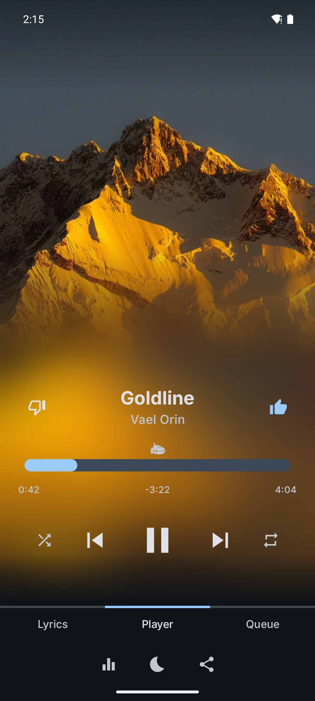
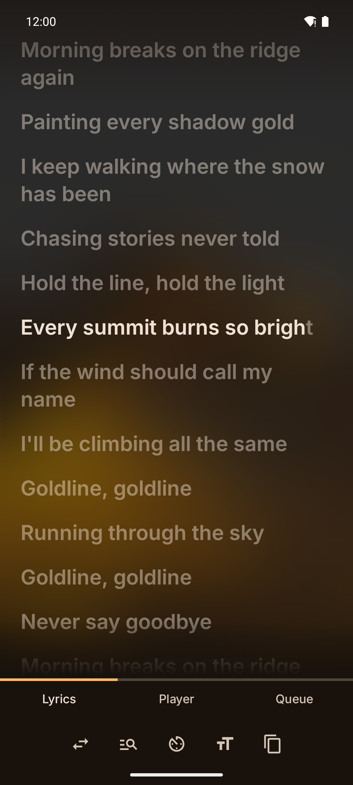
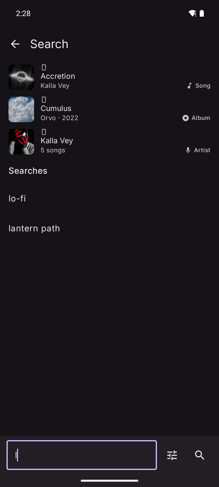
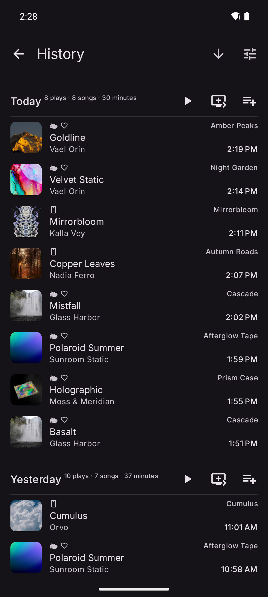
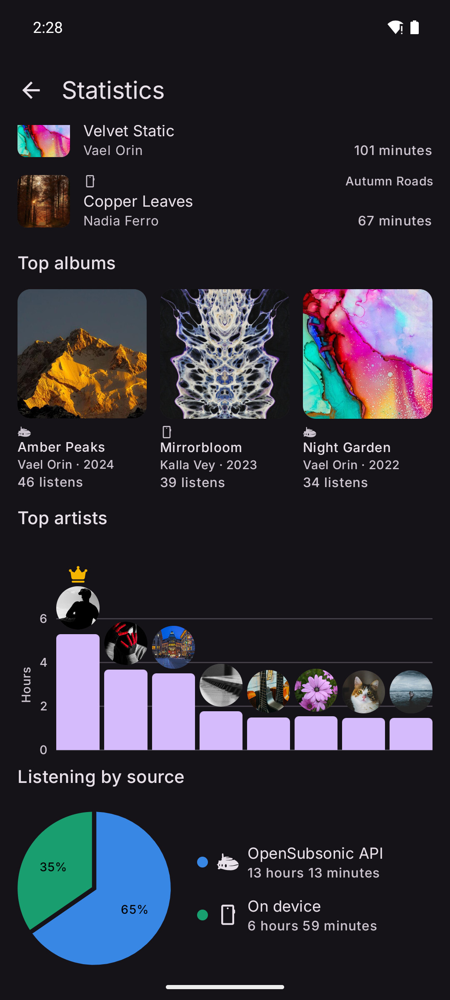
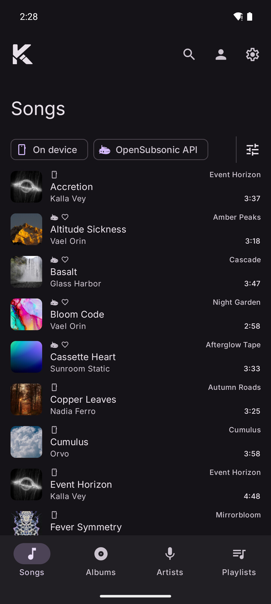
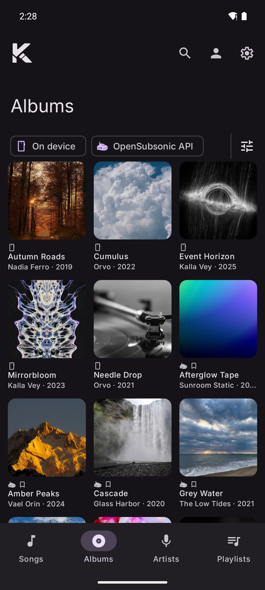
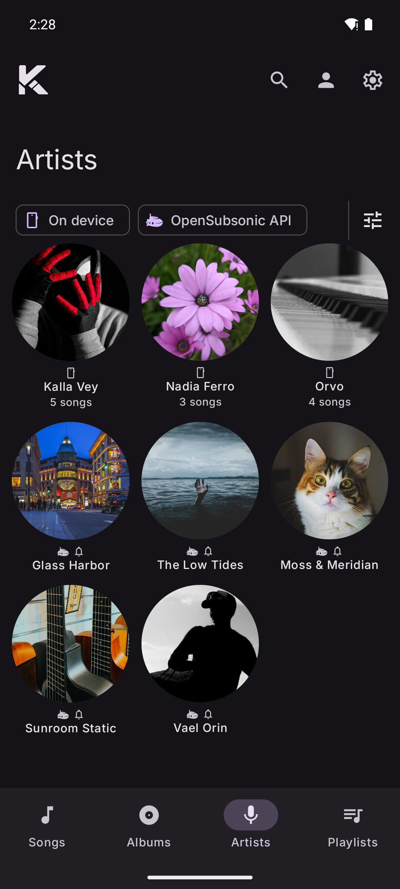
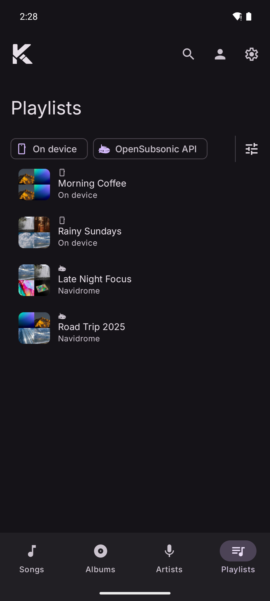

      

   

\

)\
[![IzzyOnDroid Yearly Downloads](https://img.shields.io/badge/dynamic/json?url=https://dlstats.izzyondroid.org/iod-stats-collector/stats/basic/monthly/rolling.json&query=$.['me.knighthat.kreate']&label=Downloads%20montly&logo=data%3Aimage%2Fsvg%2Bxml%3Bbase64%2CPD94bWwgdmVyc2lvbj0iMS4wIiBlbmNvZGluZz0idXRmLTgiPz48IS0tIFVwbG9hZGVkIHRvOiBTVkcgUmVwbywgd3d3LnN2Z3JlcG8uY29tLCBHZW5lcmF0b3I6IFNWRyBSZXBvIE1peGVyIFRvb2xzIC0tPg0KPHN2ZyB3aWR0aD0iODAwcHgiIGhlaWdodD0iODAwcHgiIHZpZXdCb3g9IjAgMCA0OCA0OCIgeG1sbnM9Imh0dHA6Ly93d3cudzMub3JnLzIwMDAvc3ZnIj48ZGVmcz48c3R5bGU%2BLmF7ZmlsbDpub25lO3N0cm9rZTojZmZmO3N0cm9rZS1saW5lY2FwOnJvdW5kO3N0cm9rZS1saW5lam9pbjpyb3VuZDt9LmJ7ZmlsbDojZmZmO308L3N0eWxlPjwvZGVmcz48cGF0aCBjbGFzcz0iYSIgZD0iTTI4LjE0NTMsNi4wNDgxLDIwLjk3MjYsMTcuNTRsMTMuNjYwOS4wMjI0TTE3LjE5NTgsMjMuMzc5MSw1LjYwNzEsNDEuNzIzMSIvPjxwYXRoIGNsYXNzPSJhIiBkPSJNMzQuNjMzOSwxNy41NjIxYTEyLjYsMTIuNiwwLDAsMS01LjAwOSwyNC4xNjEySDUuNjA3MW03LjIwNTMtMTEuNTE0NGExMi42LDEyLjYsMCwwLDEsNS4wMDktMjQuMTYxMkg0MS44MzkyTDMxLjU3NzUsMjIuMjkxOG0tNC44NTQyLDcuNjgzOUwxOS4zMDE3LDQxLjcyMzMiLz48cGF0aCBjbGFzcz0iYiIgZD0iTTIxLjU3LDI0LjMxNDhhLjc1Ljc1LDAsMSwxLS43NS43NUEuNzUuNzUsMCwwLDEsMjEuNTcsMjQuMzE0OFoiLz48cGF0aCBjbGFzcz0iYiIgZD0iTTI2LjgxNzIsMjQuMzE0OGEuNzUyLjc1MiwwLDEsMS0uMDA0LDBaIi8%2BPHBhdGggY2xhc3M9ImEiIGQ9Ik0yOS4zMDg4LDIwLjUxODksMjcuNDIsMjIuMzQ3NW0tOC42NC0xLjgyODYsMS44OTMyLDEuODI0NSIvPjxwYXRoIGNsYXNzPSJhIiBkPSJNMzAuMjE3NCwyNy41MTc0YTYuMTcyOCw2LjE3MjgsMCwwLDAtMTIuMzQ1NiwwWiIvPjwvc3ZnPg0K)](https://apt.izzysoft.de/packages/me.knighthat.kreate)
[![IzzyOnDroid Yearly Downloads](https://img.shields.io/badge/dynamic/json?url=https://dlstats.izzyondroid.org/iod-stats-collector/stats/basic/yearly/rolling.json&query=$.['me.knighthat.kreate']&label=Downloads%20yearly&logo=data%3Aimage%2Fsvg%2Bxml%3Bbase64%2CPD94bWwgdmVyc2lvbj0iMS4wIiBlbmNvZGluZz0idXRmLTgiPz48IS0tIFVwbG9hZGVkIHRvOiBTVkcgUmVwbywgd3d3LnN2Z3JlcG8uY29tLCBHZW5lcmF0b3I6IFNWRyBSZXBvIE1peGVyIFRvb2xzIC0tPg0KPHN2ZyB3aWR0aD0iODAwcHgiIGhlaWdodD0iODAwcHgiIHZpZXdCb3g9IjAgMCA0OCA0OCIgeG1sbnM9Imh0dHA6Ly93d3cudzMub3JnLzIwMDAvc3ZnIj48ZGVmcz48c3R5bGU%2BLmF7ZmlsbDpub25lO3N0cm9rZTojZmZmO3N0cm9rZS1saW5lY2FwOnJvdW5kO3N0cm9rZS1saW5lam9pbjpyb3VuZDt9LmJ7ZmlsbDojZmZmO308L3N0eWxlPjwvZGVmcz48cGF0aCBjbGFzcz0iYSIgZD0iTTI4LjE0NTMsNi4wNDgxLDIwLjk3MjYsMTcuNTRsMTMuNjYwOS4wMjI0TTE3LjE5NTgsMjMuMzc5MSw1LjYwNzEsNDEuNzIzMSIvPjxwYXRoIGNsYXNzPSJhIiBkPSJNMzQuNjMzOSwxNy41NjIxYTEyLjYsMTIuNiwwLDAsMS01LjAwOSwyNC4xNjEySDUuNjA3MW03LjIwNTMtMTEuNTE0NGExMi42LDEyLjYsMCwwLDEsNS4wMDktMjQuMTYxMkg0MS44MzkyTDMxLjU3NzUsMjIuMjkxOG0tNC44NTQyLDcuNjgzOUwxOS4zMDE3LDQxLjcyMzMiLz48cGF0aCBjbGFzcz0iYiIgZD0iTTIxLjU3LDI0LjMxNDhhLjc1Ljc1LDAsMSwxLS43NS43NUEuNzUuNzUsMCwwLDEsMjEuNTcsMjQuMzE0OFoiLz48cGF0aCBjbGFzcz0iYiIgZD0iTTI2LjgxNzIsMjQuMzE0OGEuNzUyLjc1MiwwLDEsMS0uMDA0LDBaIi8%2BPHBhdGggY2xhc3M9ImEiIGQ9Ik0yOS4zMDg4LDIwLjUxODksMjcuNDIsMjIuMzQ3NW0tOC42NC0xLjgyODYsMS44OTMyLDEuODI0NSIvPjxwYXRoIGNsYXNzPSJhIiBkPSJNMzAuMjE3NCwyNy41MTc0YTYuMTcyOCw2LjE3MjgsMCwwLDAtMTIuMzQ1NiwwWiIvPjwvc3ZnPg0K)](https://apt.izzysoft.de/packages/me.knighthat.kreate)

   

   

# 📲 Installation

The app is currently available on [Patreon](https://patreon.com/knighthat).

# ✨ Features

- **Multiple sources**: Supports **YouTube Music**, **OpenSubsonicAPI**, and **local songs**
- **Lyrics**: synced and plain lyrics from several sources (**BetterLyrics**, **LyricsPlus**,
  **LRCLIB** and others)
- **Downloads**: offline songs, a download queue (pause, resume, retry, cancel)
- **Song cache**: streamed songs are kept per quality and can be replayed offline.
- **Radio**: songs similar to a given song.
- **Sleep timer**: a countdown or "until the song ends", +/-, pause, stop, and restart buttons in
  notification.
- **History**: grouped by day, week and month, with date ranges and source filters.
- **Android Auto**: supports browse, playback, voice search.
- **Statistics**: all time or this month, with top songs, albums and artists, time per source, and
  charts by day, hour and weekday.
- **Sharing**: YouTube links, OpenSubsonic share links, or the local file itself.
- **Equalizer**: opens the system audio effects panel.
- **Loudness normalization**: evens out volume between songs. Local songs are also supported
- **Stream quality**: separate Wi-Fi and mobile settings for each source.
- **Open with**: plays audio files and music.youtube.com links opened from other apps.
- **MusicBrainz**: pulls information such as first release, ISRCs, genres and releases.
- And many more

# 📷 Screenshots

    
    
    
    
    
    
    
    
    

Songs and artists are made up; covers are stock photos, see <a href="fastlane/metadata/android/en-US/images/phoneScreenshots/CREDITS.md">credits</a>.

# 🌐 Supported languages

Chart and contributions are displayed in
our [official website](https://kreate.knighthat.me/translators)

    <b>Your language is not listed? <a href="https://translate.kreate.knighthat.me/project/kreate">Request one</a> now.</b>

# 🤝 Contributing

## To improve functionalities

Contributions are welcome! To develop new features or fix bugs, please fork the repository and open
a pull request.

**For more details, please refer
to** [the documentation](https://kreate.knighthat.me/dev/getting_started).

## To translate app

To **translate** or **improve a translation**, **fix typo**, or to **request new language**.

## To write documentation

**To help others understand the app, please
visit** [knighthat/Kreate-docs](https://github.com/knighthat/Kreate-docs) repository.

## If you are good at designing

UI/UX designers are welcome!

**Submit your designs
by** [opening a ticket](https://github.com/knighthat/Kreate/issues/new?template=feature_request.yaml)

# 🫂 Credits

| Type     | Authors                                                                                                                                | Notes                                                         |
|----------|----------------------------------------------------------------------------------------------------------------------------------------|---------------------------------------------------------------|
| Icons    | [Ionicons](https://github.com/ionic-team/ionicons), [FlatIcon.com](https://www.flaticon.com/), [jaimtres](https://github.com/jaimtres) | **jaimtres** designed RiMusic's Logo, many current icons      |
| App logo | [Nicouschulas](https://github.com/Nicouschulas)                                                                                        | Previous logos from [MedieroAF](https://github.com/MedieroAF) |
| Badges   | [Shields.IO](https://shields.io/), [dcbadge](https://github.com/gitlimes/dcbadge)                                                      |                                                               |

# 💸 Donation

> Help me keep the project running longer.
> This is completely optional, you don't have to pay to use/unlock any feature.

| Platform  | Address                                                                                         |
|-----------|-------------------------------------------------------------------------------------------------|
| Liberapay | https://liberapay.com/knighthat                                                                 |
| Patreon   | https://patreon.com/knighthat                                                                   |
| Monero    | 44G5dUFTbFWYfZAk69irnDUCTNZzP5viNTmkGpCNCLHjjYQq7jjRTWoYTH1aY8P841hExP31Qxg2hXPtxreKu11zCYdxQUj |
| Bitcoin   | 1GpZUvhdVkCFxqF4vuaiFxtBTxB3L94vnK                                                              |

# ⚠️ Disclaimer

Kreate is not affiliated with, funded, authorized or endorsed by YouTube, Google LLC or any of their
affiliates.
